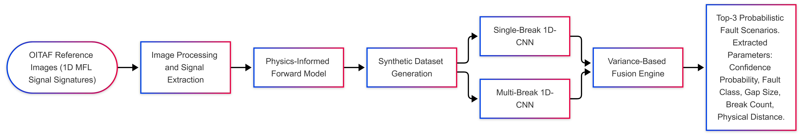
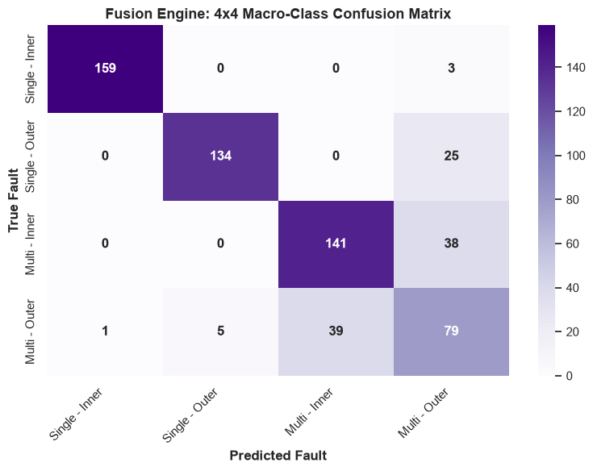

<!-- 
Image Upload Guide:
1. Create a folder named `docs` in your GitHub repository.
2. Upload your flowchart as `flowchart.png` and your 4x4 matrix as `confusion_matrix.png` inside the `docs` folder.
3. The images will automatically render below once uploaded!
-->

# Physics-Informed Deep Learning for MFL Wire Rope Inspection 🚠

> **Simulation-Based Study: An Uncertainty-Aware Sensor Fusion Framework for Single and Multi-Break Defect Diagnosis**

This repository contains the official implementation of our framework for the automated diagnosis and classification of steel wire rope defects using Magnetic Flux Leakage (MFL) signals. 

**⚠️ Note on Methodology:** All reported training, testing, and evaluation metrics in this repository are based on **synthetic, physics-informed simulated data**. The dataset is dynamically constructed from digitized OITAF reference signals (gaps of 1, 5, 10, 50, and 100 mm). Real-world field validation with sensor noise is reserved for future research.

## 🌟 Overview & Achievements
In industrial inspections, MFL signals become highly distorted when encountering overlapping multi-wire breaks. Instead of relying on unlabelled field data, this project introduces a **Physics-Informed Forward Model** to mathematically simulate thousands of complex, overlapping fault signatures with high fidelity to OITAF standards.

By leveraging two isolated **1D-CNNs** and a **Variance-based Fusion Engine**, this framework effectively extracts the hidden physical parameters of wire rope degradation (gap size, break count, and distance) directly from raw 1D signals.

### ✨ Key Features:
* **Uncertainty Estimation:** The isolated networks learn native Gaussian Negative Log-Likelihood (GNLL) variance, while the Fusion Engine utilizes *Monte Carlo Dropout* to extract epistemic uncertainty (Coefficient of Variation) for dynamic model weighting.
* **Multi-Break Support:** Capable of isolating and predicting 1 to 6 consecutive broken wires and measuring the physical distance between them.
* **Physics-Based Routing:** Applies hard physical boundary rules (e.g., average break count limits) to intelligently penalize confused predictions.
* **Robust Accuracy:** Achieves approximately **83.5%** Top-1 accuracy and **98.1%** Top-2 accuracy in distinguishing Inner and Outer fault topologies (metrics will naturally fluctuate slightly per run due to unseeded data generation).

---

## 📊 Architecture & Results


*Project Flowchart: From physics-informed dataset generation to uncertainty-aware fusion.*


*4x4 Macro-Class Confusion Matrix showcasing the model's high precision in distinguishing Inner and Outer topologies across both single and multi-break domains.*

---

## 🛠️ Getting Started

Follow these instructions to set up and run the project on your local machine.

### 1. Prerequisites
Ensure Python and Jupyter Notebook are installed, then install the required dependencies (note the addition of `scipy` for interpolation):
```bash
pip install torch numpy scipy pandas scikit-learn matplotlib seaborn jupyter
```

### 2. Dataset Generation
Due to storage constraints, the synthetic dataset is not included in this repository. To generate the physical Single and Multi-break data from scratch, open and run the following Jupyter Notebook:
* `notebooks/generate_dataset.ipynb`

*(Generated `.npz` files will be automatically saved in the designated `data/` directory. Because the generation utilizes unseeded randomness, your specific dataset and final accuracy metrics will be uniquely yours!)*

### 3. Model Training & Evaluation
To train the probabilistic 1D-CNN networks from scratch, save the weights, and evaluate the Fusion Engine's performance, open and run:
* `notebooks/train_model.ipynb`

*(This notebook handles the entire backward-model pipeline: training, weight saving, running the MC-Dropout Fusion Engine, and plotting the evaluation metrics).*

---

## 🛑 Limitations
* **Synthetic Data:** The current pipeline trains and evaluates on noise-free simulated signals. 
* **Filtered Classes:** The results and confusion matrix presented in this repository are specifically filtered for standard hauling ropes (Inner and Outer breaks). The core architecture supports King wire breaks, which can be re-enabled in the evaluator.

---

## 📄 Citation

If you find this code useful in your research or applications, please consider citing our paper:

> **Aldaghi, M., Mohammadi, S., & Mollazadeh Ghomi, M. (2026).** *A Physics-Informed Deep Learning Fusion Engine for Magnetic Flux Leakage Signal Analysis in Wire Ropes.* ISAV 2026 (Iranian Society of  on Acoustics and Vibration).
